# ESP32 SDR Handheld Scanner with LCD

This is firmware for a small 2.4 GHz scanner. It runs on an ordinary ESP32
board with a display and needs no extra radio parts. It uses the ESP32's own
Wi-Fi receiver as a software-defined radio (SDR).

With it you can:

- see the Wi-Fi networks around you and how busy each channel really is,
- watch the whole 2.4 GHz band as a waterfall,
- check the Zigbee/Thread channels,
- walk around and follow the signal strength of one network,
- find transmitters close to you, such as a phone, Bluetooth headphones or a
  smartwatch.

It runs on two boards:

| Board | Chip | Display | Extras |
|---|---|---|---|
| LILYGO TTGO T-Display | ESP32 | 1.14" ST7789, 240×135, SPI | two buttons |
| Guition JC3248W535 (JC3248W535EN) | ESP32-S3 N16R8 | 3.5" AXS15231B, 480×320, QSPI, touch | gapless capture, BLE device list |

The project is based on two others:

- [ESPARGOS/esp-sdr](https://github.com/ESPARGOS/esp-sdr) found a debug path
  in the ESP32 that delivers raw I/Q samples from the Wi-Fi receiver. The
  receiver code and the serial protocol come from there.
- [Skydev0h/esp-sdr-glow](https://github.com/Skydev0h/esp-sdr-glow) is a fork
  for the ODROID-GO handheld with a spectrum display on the device. This
  project grew out of it.

Their READMEs are in [docs/esp-sdr-glow-README.md](docs/esp-sdr-glow-README.md).
Everything described there still works, including the browser viewer over USB.

<p align="center">
  
  
</p>

The screen pictures in this README are drawn by
[tools/readme_images.py](tools/readme_images.py). They follow the firmware's
layout and use made-up but typical data.

---

## Contents

- [How it works](#how-it-works)
- [On the device](#on-the-device)
- [Survey mode: networks and channel load](#survey-mode-networks-and-channel-load)
- [Sniffer mode: find active devices](#sniffer-mode-find-active-devices)
- [Controls](#controls)
- [Colour themes](#colour-themes)
- [Flash a ready-made firmware](#flash-a-ready-made-firmware)
- [Build from source](#build-from-source)
- [Hardware details](#hardware-details)
- [Serial diagnostics](#serial-diagnostics)
- [Limitations](#limitations)
- [Repository layout](#repository-layout)
- [License and credits](#license-and-credits)

---

## How it works

Normally the ESP32's Wi-Fi receiver passes everything it hears to the Wi-Fi
modem, which decodes packets. ESP-SDR found a debug path that copies the raw
samples from the receiver's ADC into RAM instead (10 bit I/Q, up to 80 million
samples per second). This firmware uses that path.

<p align="center"></p>

The receiver is tuned to 2442 MHz and records short pieces of 0.1 to 0.2 ms.
At 80 million samples per second one recording covers the whole band from
2408 to 2476 MHz. The chip then works out the spectrum and the channel load
itself.

**Channel load (airtime).** Each recording is cut into slices of 12.8 µs. A
slice counts as busy for a channel when the power in the middle 16 MHz of
that channel is more than 6 dB above the noise floor. The share of busy
slices over about 2 seconds is the airtime in percent. No packets are
decoded, so it counts everything that transmits on the channel: your own
network, the neighbours' networks, hidden networks, Bluetooth, Zigbee, even a
microwave oven.

**Network names.** The names come from a normal Wi-Fi scan, which is a
different thing from the SDR measurement. A scan pauses the measurement for
0.15 to 0.3 s, so it only runs when it is needed:

- once at start,
- when you open WATERFALL, NETWORKS or CHANNELS WIFI,
- every 9 s while NETWORKS is open,
- when you ask for it (next-page key held 1 s).

If you carry the board around, hold the next-page key for 2 s on WATERFALL or
CHANNELS WIFI. This switches on periodic scanning: every second one third of
the band is scanned, and the header shows `scan auto`. Hold it 2 s again to go
back to `scan manual`. The display keeps drawing during a scan. Only the
measurement pauses.

**Gain.** The receiver's automatic gain control sets the gain for every
packet. Each sample carries its gain value, and the firmware scales all
samples back to the same level. A phone right next to the board doing a
speed test therefore does not overload the picture.

---

## On the device

Screenshots from a JC3248, taken over the serial port with `TDSCREEN`.
Network names and device addresses are blacked out. The numbered pictures in
the sections below are drawings with example data, so that each part can be
pointed at.

| | | |
|---|---|---|
| 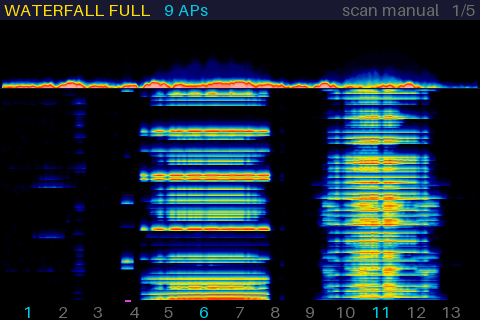 | 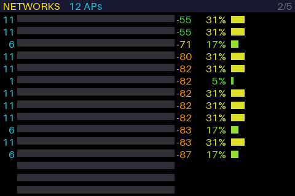 | 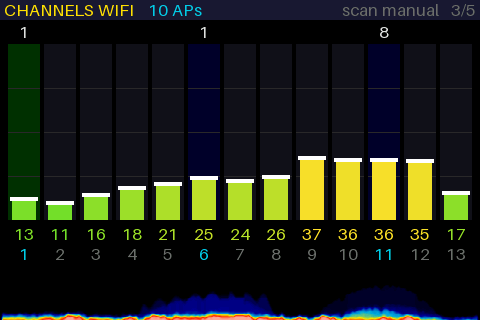 |
| WATERFALL FULL | NETWORKS | CHANNELS WIFI |
| 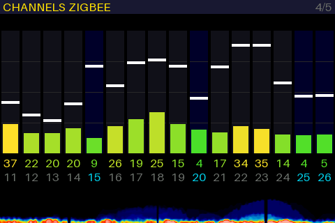 | 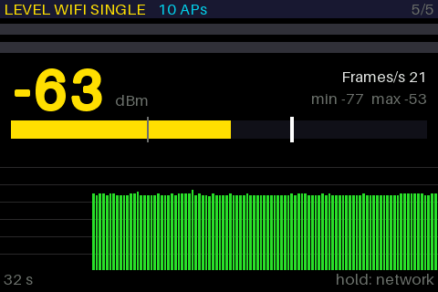 | 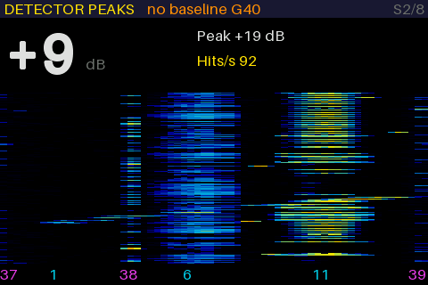 |
| CHANNELS ZIGBEE | LEVEL WIFI SINGLE | DETECTOR PEAKS (not zeroed) |
| 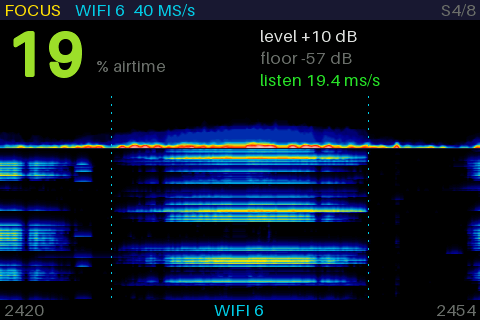 | 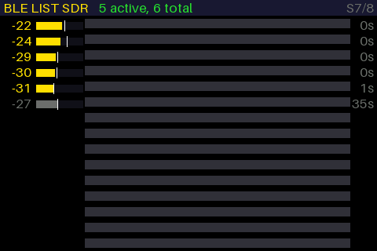 | 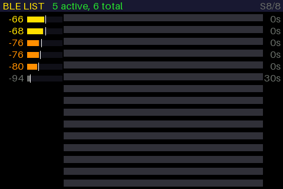 |
| FOCUS WIFI | BLE LIST SDR | BLE LIST |

The same pages on the T-Display (240×135):

| | | |
|---|---|---|
| 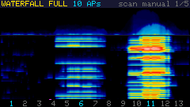 | 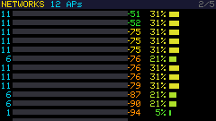 | 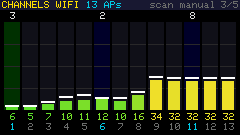 |
| WATERFALL FULL | NETWORKS | CHANNELS WIFI |
| 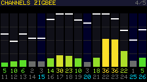 | 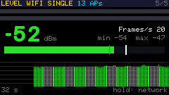 | 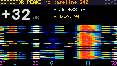 |
| CHANNELS ZIGBEE | LEVEL WIFI SINGLE | DETECTOR PEAKS (not zeroed) |
| 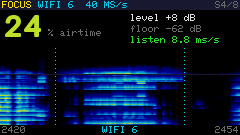 | 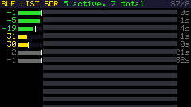 | |
| FOCUS WIFI | BLE LIST SDR | |

---

## Survey mode: networks and channel load

The board starts in survey mode. The next-page key steps through five pages:
WATERFALL FULL, NETWORKS, CHANNELS WIFI, CHANNELS ZIGBEE and LEVEL WIFI SINGLE.

### WATERFALL FULL


1. **Header:** page name, number of networks from the last scan, and the page
   number. `AUTO` or `CLIP` appear here when they are active.
2. **Spectrum (phosphor display):** every recording adds a bit of light where
   its curve lies, and the light fades within about a second. A level that
   comes back again and again glows bright. A peak that shows up only once
   stays faint. The picture is slightly smoothed.
3. **Waterfall:** the newest row is at the top, and the page shows about 7 s.
   Each row shows how often each frequency was busy. A Wi-Fi network shows up
   as a band 20 MHz wide. Each column is compared with its own quiet level, so
   a constant carrier fades out and bursts stand out.
4. **Bluetooth LE advertising:** short dashes on the BLE advertising channels
   37, 38 and 39 (2402, 2426 and 2480 MHz, marked magenta on the axis).
5. **Channel numbers 1 to 13:** channels 1, 6 and 11 in cyan, the rest grey.
   The airtime per channel is on CHANNELS WIFI.

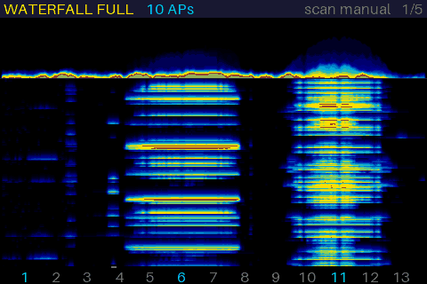

Recorded on a JC3248 with `TDSCREEN` (5 s, about 3 frames per second, the
board itself draws about 24).

### NETWORKS


1. Channel.
2. Network name. `<hidden>` is a network that does not send its name.
3. Signal strength in dBm: green is strong, yellow medium, orange weak.
4. Measured airtime of that channel.
5. The same airtime as a bar (full width is 100 %).

If there are more networks than fit on the screen, the list turns a page
every 4 s.

### CHANNELS WIFI


1. Number of networks on the channel.
2. Airtime bar (full height is 100 %).
3. White mark: the highest airtime of the last few seconds.
4. Green column: the quietest of channels 1, 6 and 11. That is the best
   choice for a new network.
5. Airtime in percent.
6. Channel number.

The network counts come from the last scan. With periodic scanning on, every
channel is updated every 3 s.

Airtime colours: green up to about 15 %, yellow around 40 %, red from 75 %.
Wi-Fi channels overlap, so a busy network on channel 6 also colours channels 3
to 9.

### CHANNELS ZIGBEE


This page shows the IEEE 802.15.4 channels 11 to 26, which Zigbee, Thread and
Matter use. Each is 2 MHz wide. Channel n sits at 2405 + 5·(n − 11) MHz. For
this page the receiver switches between 2422 and 2462 MHz, so that channels 11
and 26 at the band edges are covered too.

1. Channels 15, 20, 25 and 26 (blue column, cyan number) lie between Wi-Fi
   channels 1, 6 and 11. They are the usual choice for a Zigbee network.
2. Level above the noise floor (full height is 40 dB), coloured by activity.
3. White mark: recent peak level.
4. Activity: how much of the time the channel was busy, in percent.
5. Channel number.

### LEVEL WIFI SINGLE


This page follows the signal strength of one Wi-Fi network. Use it to walk
through a building and see where the coverage ends.

The radio stays on that network's channel and reads the signal strength of
every frame the access point sends. That is ten beacons per second plus all
its traffic. While this page is open, there are no scans and no SDR
measurements.

The page starts with the strongest network from the NETWORKS list. Hold the
mode key for the next network or the next-page key for the previous one. If
you keep holding, it moves on once per second.

1. Network name, channel and MAC address.
2. Signal strength in dBm (green strong, yellow medium, orange weak). After
   1 s without a frame it shows `--` and `no signal`.
3. Frames per second, and the lowest and highest value since you chose the
   network.
4. Bar from −100 to −30 dBm. The grey mark is the lowest value, the white
   mark the highest.
5. History of the last 32 s, one bar per 250 ms (the strongest frame in that
   time). The example shows walking away from the access point and back, with
   a short gap where nothing was heard.
6. `hold: network` reminds you that holding a key changes the network.

---

## Sniffer mode: find active devices

A short press on the mode key switches between survey mode and sniffer mode.

The sniffer pages measure field strength. A phone or headphones in a bag 30
to 50 cm away arrive 15 to 30 dB stronger than the routers and devices
elsewhere in the room. That works even in a busy room. What typical devices
look like:

- **Bluetooth headphones playing music:** dots all over the band. Classic
  Bluetooth changes its frequency 1600 times per second.
- **BLE devices (watch, earbuds, tracker):** short dots on channels 37, 38
  and 39.
- **Phone:** Wi-Fi bands 20 MHz wide, plus BLE.

A short press on the next-page key steps through the sniffer pages.

### FINDER WIDEBAND

A big number shows how many dB the strongest signal is above the room (or
above the noise, if the page has not been zeroed). Below it are a history and
a waterfall from 2400 to 2484 MHz. The receiver's filter is narrower than the
band, so this page records at two frequencies (2422 and 2462 MHz) in turn.
FINDER shows where in the band something transmits. It works best for
devices that transmit all the time.

The thin line at 2442 MHz in the waterfall is where the two halves meet.

### DETECTOR PEAKS


This page does in software what an analogue RF detector does in hardware. The
receiver records runs of 25 ms at 80 million samples per second and splits
them into 64 channels of 1.25 MHz (2402 to 2481 MHz), a new set every 16 µs.
A BLE packet lasts at least 80 µs, so it is seen several times, and each
channel only carries 1.25 MHz worth of noise. DETECTOR shows whether and
when something transmits, and it catches short packets well.

- On the JC3248 (ESP32-S3) the runs have no gaps. The receiver listens about
  a third of the time. The rest of the time goes into drawing the display.
- On the T-Display (ESP32) it records pieces of 193 µs one after another.
  One core records the next piece while the other core analyses the last one.

1. Zeroing status, with the gain (`G34`) and how long ago it was zeroed.
2. Big number: how many dB the strongest signal is above the learned room.
3. Highest value since zeroing.
4. Hits per second.
5. Bright dashes: transmissions above the room.
6. The room itself, shown faint. Here it is an access point on channel 6.
7. Axis: BLE advertising channels in magenta, Wi-Fi 1, 6 and 11 in cyan.

### BEARING STRONGEST

This page helps you find the direction of a source. It shows a big number, a
bar with a mark for the best value since the page was opened, and an arrow:
a green ▲ when the signal gets stronger, a cyan ▼ when it gets weaker.

Hold the board in front of your chest and turn slowly. Your body weakens
signals coming from behind by 10 to 20 dB. Where the number is highest, the
source is in front of you.

### FOCUS WIFI / FOCUS BLE / FOCUS ZIGBEE

The other pages watch the whole band. A FOCUS page watches one channel and
listens to it longer.

Analysing a recording takes the same time per sample, whatever the sample
rate. A recording with the same number of samples taken at a lower rate
therefore covers a longer time. The span gets narrower, but one channel still
fits. The FOCUS pages use the receiver's sample rates of 40 and 16 million
samples per second (MS/s).

| Page | Channels | Rate | Span | Frequency step | Listening time, JC3248 | Listening time, T-Display |
|---|---|---|---|---|---|---|
| (survey, whole band) | | 80 MS/s | 2400–2484 MHz | 0.31 MHz | 9.3 ms per second | 4.8 ms per second |
| FOCUS WIFI | 1–13 (20 MHz) | 40 MS/s | about 34 MHz | 0.16 MHz | about 20 ms per second (2.2×) | about 9.5 ms per second (2×) |
| FOCUS BLE | 37, 38, 39 (2 MHz) | 16 MS/s | about 13 MHz | 0.06 MHz | 49 ms per second (5.3×) | 24 ms per second (5×) |
| FOCUS ZIGBEE | 11–26 (2 MHz) | 16 MS/s | about 13 MHz | 0.06 MHz | 49 ms per second (5.3×) | 24 ms per second (5×) |

The finer frequency step helps too. Each step holds less noise, so a weak
signal on a 2 MHz channel stands out more clearly.

FOCUS measures the energy on a channel, no matter who sends it. To see the
level of one particular network, use LEVEL WIFI SINGLE.

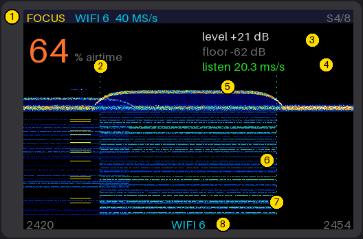

1. Header: FOCUS, the channel and the sample rate, and the page number.
2. Airtime: how much of the time the channel is busy.
3. Level of the channel above the noise floor, and the noise floor.
4. Listening time per second.
5. Spectrum, as on WATERFALL FULL. In this example channel 6 is busy, and the
   upper half of channel 3 shows weaker at the left edge.
6. Waterfall, newest row at the top.
7. The channel lies between the two dotted cyan lines.
8. Axis with the edges of the span in MHz and the channel name.

<p>
  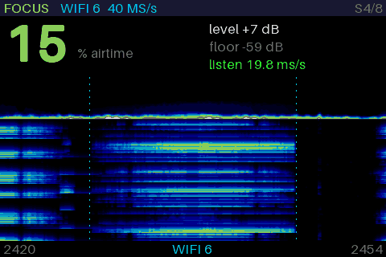<br>
  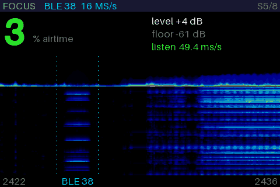
  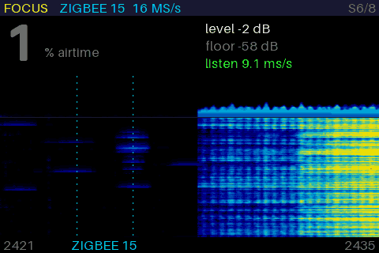
</p>

FOCUS WIFI 6, FOCUS BLE 38 and FOCUS ZIGBEE 15, recorded on a JC3248 with
`TDSCREEN`. While a frame goes out over USB the receiver waits, because the
USB traffic would show as lines in the spectrum. So the listening time
shown in these recordings is much lower than in normal use.

Hold the next-page key for the next channel and the mode key for the previous
one. If you keep holding, it moves on once per second, so you can hold until
the channel you want comes up. Each page remembers its channel after a
restart. The first time, FOCUS WIFI starts on the channel of the strongest
network, FOCUS BLE on 38 and FOCUS ZIGBEE on 15.

For a 2 MHz channel the receiver is tuned 3 MHz to one side, so its own DC
signal does not land on the channel. A Wi-Fi channel is too wide for that.
The receiver sits in its middle, and the analysis leaves out about 0.8 MHz
there. The display fills that gap from the columns next to it. Wi-Fi leaves
the middle of its channel empty anyway. The Wi-Fi page uses the receiver's
38 MHz filter, which is flat to within about 2 dB over the whole span.

On the JC3248, DETECTOR PEAKS already listens to the whole band without
gaps, and FOCUS adds a finer frequency step. On the T-Display, FOCUS is
also the page that listens the longest.

### BLE LIST SDR

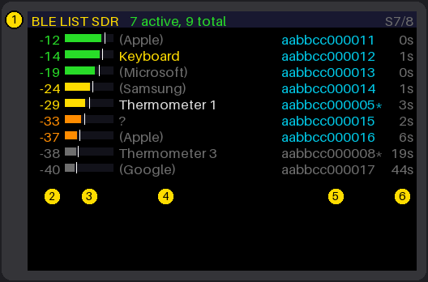

This page lists Bluetooth LE devices without a Bluetooth stack. It decodes
the advertising packets from the receiver's own samples, using the GFSK
decoder of the [ESPsoup firmware](https://github.com/pit711/espsoup-firmware).
On the T-Display this is the only BLE list. On the JC3248 it works without
the restart that BLE LIST needs.

The page listens to the advertising channels 37, 38 and 39 in turn, one
second each, with a fixed gain. Each recording is 1 ms long at 16 MS/s. A
packet is only decoded when it fits completely into one recording.

1. Devices heard recently, and in total.
2. Level in dBFS, averaged. This is relative to the receiver's full scale,
   not a calibrated dBm value. Near devices read about −10 to −20 dBFS,
   weak ones −35 and lower.
3. Level bar from −50 to 0 dBFS. The white mark is the strongest packet.
4. Name from the advertising data, else the manufacturer, as on BLE LIST.
5. Address. `*` marks a fixed (public) address.
6. Seconds since the device was last heard.

Hold the next-page key to clear the list.

Compared with BLE LIST, measured on the JC3248 at the same place:

- It finds fewer devices. In one test BLE LIST showed 16 devices, 8 of them
  weaker than −80 dBm, while BLE LIST SDR found about the 6 to 10 stronger
  ones. The SDR path is roughly 15 to 20 dB less sensitive than the
  Bluetooth receiver, although both use the same radio.
- It fills and updates more slowly. The receiver listens about 30 % of the
  time on the JC3248 (335 recordings per second, two decoders on two cores)
  and about 22 % on the T-Display (216 per second, one decoder: there is no
  room for the second one's buffer). The Bluetooth stack listens all the
  time.
- A very strong device right next to the board (more than about −5 dBFS)
  overloads the receiver and hides weaker ones.

### BLE LIST (JC3248 only)


This is a normal BLE scan, like a "BLE scanner" app on a phone, including
BLE 5 extended advertising. Use it for devices that transmit too little to
stand out from the Wi-Fi in the room, for example a smartwatch that is
connected to its phone.

1. Devices heard recently, and in total.
2. Signal strength in dBm, averaged.
3. Signal bar from −100 to −30 dBm. The white mark is the strongest packet.
4. Name. If the device sends no name, the manufacturer is shown instead
   (Apple, Samsung, Google, Garmin and others). A yellow name was seen for
   the first time within the last 10 s.
5. MAC address as phone apps show it. `*` marks a fixed (public) address.
6. Seconds since the device was last heard. After 15 s it turns grey and
   moves down, after 2 minutes it is removed.

The nearest device is at the top. Hold the next-page key to clear the list.

The Bluetooth stack and the SDR receiver do not fit into the ESP32-S3's
internal RAM at the same time. Opening or leaving this page therefore
restarts the board, which takes about 1.5 s. Watches and phones change their
random MAC address every few minutes and then show up as a new entry.

### Zeroing

Zeroing teaches a sniffer page what the room normally looks like, so that a
new source stands out. Hold the next-page key on a sniffer page and keep the
board still for 6 to 15 s. The header shows the steps:

1. `ranging G..` (DETECTOR only): the board picks a fixed gain so that the
   strongest signal in the room is 10 to 35 dB below the maximum.
2. `learning`: it records the highest level the room reaches at each
   frequency.
3. `checking +2dB`: it adds 2 dB to that maximum and counts how many points
   still light up in the unchanged room. If more than 0.3 % do, it adds
   another 2 dB and checks again.
4. `zeroed +4dB`: done. The number is the margin this room needed.

After that the reference stays fixed. Otherwise the board would slowly learn
away a device you are standing next to. The header shows the margin and the
age, for example `zeroed +4dB 2:15`. Hold the mode key to remove the zeroing
(`no baseline`).

---

## Controls

There are two keys:

| Key | T-Display | JC3248 |
|---|---|---|
| Next-page key | left button (GPIO0) | right half of the screen, or the BOOT button |
| Mode key | right button (GPIO35) | left half of the screen |

What they do:

| Key | Short press | Hold (1 s) |
|---|---|---|
| Next-page | next page | Survey: scan for networks now. On WATERFALL and CHANNELS WIFI, keep holding to 2 s to switch periodic scanning on or off. LEVEL WIFI SINGLE: previous network. Sniffer: zero the page. FOCUS: next channel. BLE LIST and BLE LIST SDR: clear the list. |
| Mode | switch between survey and sniffer | Survey: next colour theme. LEVEL WIFI SINGLE: next network. Sniffer: remove the zeroing. FOCUS: previous channel. |

While you hold a key, a thin bar at the top of the header fills up from left
to right. When it is completely red, the hold is done and you can let go.
Where a hold has two steps (scan at 1 s, periodic scanning at 2 s), the bar
runs for 2 s and has a white mark at 1 s.

On the touch screen, if your finger loses contact for less than 0.12 s
during a hold, it still counts as one hold.

## Colour themes

In survey mode, hold the mode key to change the colour theme. There are
seven: Classic, Inferno, Viridis, Turbo, Phosphor (green), Night (red) and
Mono. The theme is used for all waterfalls and spectra. Night turns the whole
screen red, including text and bars, so it does not spoil your night vision.
The theme's name shows in the header for 2 s. The board saves it and uses it
again at the next start.

<p align="center"></p>

The waterfalls fade slowly: each new row is mixed with the one before it, so
weak signals stay visible for a while as dark colours.

---

## Flash a ready-made firmware

The [firmware/](firmware) folder has complete images (bootloader, partition
table and app). Flash them at address 0x0.

| File | Board |
|---|---|
| [firmware/tdisplay-firmware.bin](firmware/tdisplay-firmware.bin) | LILYGO TTGO T-Display |
| [firmware/jc3248-firmware.bin](firmware/jc3248-firmware.bin) | Guition JC3248W535 |

**In the browser** (Chrome or Edge, nothing to install):

1. Open <https://espressif.github.io/esptool-js/>.
2. Plug in the board, click Connect and choose its serial port. On a Mac it
   is called something like `cu.usbserial-…`, `cu.wchusbserial…` or
   `cu.usbmodem…`. Use 921600 baud.
3. Enter flash address `0x0`, choose the `.bin` file and click Program.
4. Click Disconnect, then press reset or unplug and replug the board.

**With esptool** (`pip install esptool`):

```sh
esptool --chip esp32   -p /dev/ttyUSB0 -b 921600 write-flash 0x0 firmware/tdisplay-firmware.bin
esptool --chip esp32s3 -p /dev/ttyACM0 -b 921600 write-flash 0x0 firmware/jc3248-firmware.bin
```

If the JC3248 does not show up as a serial port, hold its BOOT button while
you plug it in.

Flashing a complete image also clears the saved settings (colour theme and
FOCUS channels).

---

## Build from source

The firmware calls internal functions of the Wi-Fi driver that are not part
of the public API. It therefore only builds with exactly this ESP-IDF commit,
which is also listed in [firmware-targets.json](firmware-targets.json):
`25fe69f946311abdaf9ad56591f25fedbc20ac98` (ESP-IDF master, 2026). PlatformIO
and the Arduino IDE cannot build it.

[ESP-DSP](https://github.com/espressif/esp-dsp) is included as a git
submodule in `components/esp-dsp`. Clone with `--recursive`, or run
`git submodule update --init` afterwards.

### 1. Install ESP-IDF at the right commit

Linux and macOS:

```sh
git clone https://github.com/espressif/esp-idf ~/esp/esp-idf-sdr
cd ~/esp/esp-idf-sdr
git checkout 25fe69f946311abdaf9ad56591f25fedbc20ac98
git submodule update --init --recursive
./install.sh esp32,esp32s3
. ./export.sh
```

Windows (PowerShell). Keep the paths short, because a deep ESP-IDF build
runs into Windows' limit of 260 characters per path.

```powershell
git clone https://github.com/espressif/esp-idf C:\esp\esp-idf-sdr
cd C:\esp\esp-idf-sdr
git checkout 25fe69f946311abdaf9ad56591f25fedbc20ac98
git submodule update --init --recursive
$env:IDF_TOOLS_PATH = 'C:\esp\tools'
.\install.ps1 esp32,esp32s3
. .\export.ps1
```

### 2. Build and flash

Each board has its own build folder and its own configuration file
(`sdkconfig.defaults.tdisplay` and `sdkconfig.defaults.jc3248`):

```sh
git clone --recursive https://github.com/doctormord/ESP32-SDR-Handheld-scanner-with-LCD sdr-scanner
cd sdr-scanner

# LILYGO TTGO T-Display (ESP32)
idf.py -B build-tdisplay -DIDF_TARGET=esp32 \
  -DSDKCONFIG=build-tdisplay/sdkconfig \
  -DSDKCONFIG_DEFAULTS=sdkconfig.defaults.tdisplay build
idf.py -B build-tdisplay -p /dev/ttyUSB0 flash

# Guition JC3248W535 (ESP32-S3)
idf.py -B build-jc3248 -DIDF_TARGET=esp32s3 \
  -DSDKCONFIG=build-jc3248/sdkconfig \
  -DSDKCONFIG_DEFAULTS=sdkconfig.defaults.jc3248 build
idf.py -B build-jc3248 -p /dev/ttyACM0 flash
```

On Windows, put the build folder on a short path (for example
`-B C:\esp\build-jc3248` with `-DSDKCONFIG=C:/esp/build-jc3248/sdkconfig`), or
use [tools/flash.ps1](tools/flash.ps1):

```powershell
powershell -ExecutionPolicy Bypass -File tools\flash.ps1 -Board jc3248 -Port COM8
```

If you change an `sdkconfig.defaults.*` file, delete the `sdkconfig` in the
build folder (or the whole build folder). ESP-IDF only applies the defaults
to options that are not set yet.

### 3. Make a single image for the browser flasher

```sh
cd build-tdisplay
esptool --chip esp32 merge-bin -o ../firmware/tdisplay-firmware.bin \
  --flash-mode dio --flash-freq 40m --flash-size 4MB \
  0x1000 bootloader/bootloader.bin 0x8000 partition_table/partition-table.bin 0x10000 esp_sdr.bin

cd ../build-jc3248
esptool --chip esp32s3 merge-bin -o ../firmware/jc3248-firmware.bin \
  --flash-mode dio --flash-freq 80m --flash-size 16MB \
  0x0 bootloader/bootloader.bin 0x8000 partition_table/partition-table.bin 0x10000 esp_sdr.bin
```

### Settings

You can change these in `sdkconfig.defaults.<board>` or with
`idf.py menuconfig` under *ESP-SDR board*:

| Option | Default | Meaning |
|---|---|---|
| `CONFIG_ESP_SDR_SCAN_INTERVAL_S` | 9 | Seconds for one full network scan over channels 1 to 13 (done in 3 short parts). 0 means only on request. |
| `CONFIG_ESP_SDR_PAGE_SECONDS` | 0 | 0 means pages only change by key. Any other value changes the page automatically after that many seconds. |
| `CONFIG_ESP_SDR_TDISPLAY_SPI_MHZ` | 80 | SPI clock of the T-Display. Use 40 if your board shows pixel errors. |

---

## Hardware details

### LILYGO TTGO T-Display (ESP32)

- Display ST7789 on SPI3: MOSI 19, SCLK 18, CS 5, DC 16, RST 23, backlight 4.
  If a clone shows the picture turned or with red and blue swapped, change
  `MADCTL` or `ROW_OFFSET` in
  [main/boards/tdisplay/lcd.c](main/boards/tdisplay/lcd.c).
- Buttons on GPIO0 (left) and GPIO35 (right).
- Serial port through the USB bridge chip (CH9102 or CP210x) at 2 Mbaud.
- No PSRAM. About 50 frames per second.
- Core 0 runs Wi-Fi and the measurements, core 1 draws the screen (and
  analyses the detector's recordings). If enough RAM is free, it keeps a
  whole frame (65 KB) and draws it while core 0 measures. `TDSTAT?` ends with
  `framebuf 0` or `framebuf 1`.

### Guition JC3248W535 (ESP32-S3)

- PSRAM and flash run at 120 MHz instead of 80 MHz, as in the vendor's own
  demos. That gives about 3 more frames per second. Espressif calls octal
  PSRAM at 120 MHz experimental: the chip can crash if its temperature
  changes by about 20 °C after power-on. In daily use it has been stable. To
  go back to 80 MHz, delete the 120 MHz block at the end of
  `sdkconfig.defaults.jc3248` and the `sdkconfig` in the build folder.
- After a software restart (opening or leaving the BLE list), the USB serial
  port sometimes stays silent until you unplug the board once. The board
  itself keeps running.
- Display AXS15231B, 320×480 portrait, on QSPI (SPI2): CS 45, SCK 47,
  D0–D3 = 21/48/40/39, backlight 1. It runs at 40 MHz. At 80 MHz it showed
  lines across the picture.
- Core 0 measures, core 1 draws. There are two frame buffers in PSRAM: one is
  drawn while the other is sent to the display. WATERFALL FULL runs at about
  24 frames per second, with 45 recordings per second of 0.2 ms each (the
  T-Display uses 0.1 ms).
- The display is updated in 40 strips. Strips that did not change since they
  were last sent are skipped, and once every 2 s the whole picture is sent.
  Quiet pages send only a few strips, the waterfall sends all of them.
  `TDSTAT?` shows how many went out (`chunks`).
- Touch controller on I²C: SDA 4, SCL 8, address 0x3B. BOOT button on GPIO0.
- 16 MB flash, 8 MB octal PSRAM.
- USB serial through the chip's own USB-C port.
- The gapless recording uses the internal RAM area 0x3FCB0000–0x3FCE0000,
  which is taken out of the heap.

These projects helped to get the board running:
[DaradiciLevente/JC3248W535C-EspHome-NTP-Clock](https://github.com/DaradiciLevente/JC3248W535C-EspHome-NTP-Clock),
[AudunKodehode/JC3248W535EN-Touch-LCD](https://github.com/AudunKodehode/JC3248W535EN-Touch-LCD),
[HASwitchPlate/openHASP](https://github.com/HASwitchPlate/openHASP).
Another display port of ESP-SDR:
[NeoCat/esp-sdr-TDongleC5-LCD](https://github.com/NeoCat/esp-sdr-TDongleC5-LCD).

---

## Serial diagnostics

You can send commands over the serial port: 2 Mbaud on the T-Display, any
baud rate on the JC3248. Open the port with DTR and RTS switched off,
otherwise the board resets (in Python: `dtr=False, rts=False`). On macOS the
board may reset anyway when the port opens. Wait about 8 s before sending.

[tools/serial_tests.py](tools/serial_tests.py) sends commands and runs the
usual measurements, for example recordings per second on each page, or the
`TDRATE` and `TDFOCUS?` checks.

| Command | What it does |
|---|---|
| `TDSTAT?` | Survey status: page, gain, clipping, frame time, touch point (JC3248). |
| `TDSCREEN` / `TDSCREEN 2` | Screenshot: the drawing task sends the next frame as it is drawn (a line `TDSCREEN w h`, then w × h pixels in RGB565, high byte first, then `TDSCREEN END` with the CRC-32 of the pixel bytes). `2` averages 2 × 2 pixels (a quarter of the data). Recordings wait while a frame goes out. `tools/serial_tests.py PORT screen file.png` saves a PNG, `… gif file.gif --secs 5 --colors 32` an animated GIF. |
| `TDPAGE n` / `TDSNIFF 0\|1` / `TDSNPAGE n` | Switch the survey page / the mode / the sniffer page (0 FINDER, 1 DETECTOR, 2 BEARING, 3 to 5 FOCUS WIFI, BLE, ZIGBEE, 6 BLE LIST SDR, 7 BLE LIST). |
| `TDSCAN` / `TDSCANAUTO 0\|1` | Scan for networks now / periodic scanning off or on. |
| `TDSCANCH c [ms]` | Scan only channel `c` (passively for `ms` milliseconds, if given) and list every answer (T-Display). |
| `TDSN?` / `TDNULL` | FINDER status / zero FINDER. |
| `TDDET?` / `TDDETZERO` | DETECTOR status (gain, floor, room, margin) / zero DETECTOR. |
| `TDSPEC s [gain]` | DETECTOR listens for `s` seconds with the display paused, then prints for each channel the strongest power and how often it was 15 dB above the median. Useful to check whether a device transmits at all. |
| `TDZB?` | Zigbee channels: level and activity per channel. |
| `TDCOV?` / `TDCOVSEL -1\|0\|1` | LEVEL WIFI SINGLE: network, channel, signal, lowest, highest, frames per second / choose the previous, strongest or next network. |
| `TDBLE?` | BLE LIST: every device with MAC, address type, signal, average, highest, manufacturer, packets, age and name. |
| `TDBS?` | BLE LIST SDR: channel, recordings decoded by each of the two decoders, packets, valid packets, devices. |
| `TDBLESDR ch s [gain [sign [filt [bw]]]]` | Decodes BLE advertising on channel `ch` (37 to 39) for `s` seconds with the display paused, and lists the advertisers with packet count and level. `gain` default 50. `filt 1` puts a low-pass filter in front of the decoder, `bw` sets the analogue filter (default 15 MHz). Also prints how many valid packets of each type arrived. |
| `TDFOCUS?` / `TDFOCUS n` | FOCUS status: channel, sample rate, recordings per second, listening time, airtime, level, floor / choose channel `n` (0 to 12 = Wi-Fi 1 to 13, 13 to 15 = BLE 37 to 39, 16 to 31 = Zigbee 11 to 26). It is saved as that page's channel. In sniffer mode the board also switches to that page. |
| `TDPROBE f0 f1 step [n]` | Tunes from `f0` to `f1` MHz in steps of `step` and takes `n` recordings at each frequency (default 20). Prints the noise floor, the strongest line and where it is, and how many recordings had a short burst. |
| `TDSPAN d lo bw n` | Measures how flat the noise floor is across the span. `d` is the sample rate as in `TDRATE`, `lo` the frequency in MHz, `bw` the filter width in MHz, `n` the number of recordings. Prints the floor in 2 MHz steps. |
| `TDRATE 0\|1\|6 [lo]` | Checks a sample rate (0 = 80, 1 = 40, 6 = 16 MS/s). It looks for the known signal of the 40 MHz crystal at 2440 MHz and prints where it was found and where it should be. Default frequency is 2442 MHz. |
| `TDSPINOISE [n]` | Shows what display traffic during a recording would cost. Takes `n` pairs of recordings (default 40), one with the display quiet and one while it is being updated, and compares them (survey mode only). |

The ESP-SDR protocol (`INFO`, `FREQ`, `CAP` and so on) and the
[browser viewer](https://espargos.net/espsdr/app/) still work. While a
computer uses the receiver, the display says so and pauses.

### Why recordings wait for the display

Sending a picture to the display causes interference in the receiver. So
every recording waits until the display connection is quiet. `TDSPINOISE 100`
shows the difference, measured in a room with Wi-Fi traffic (two runs per
board, gain 50, automatic gain off):

| Recording during display traffic | JC3248W535 (QSPI, 40 MHz) | T-Display (SPI, 80 MHz) |
|---|---|---|
| Noise floor | 2.1 to 2.3 dB higher | 1.5 dB higher |
| Whole spectrum, average | 3.4 to 3.6 dB higher | 2.1 dB higher |
| Frequency steps more than 6 dB higher | 13 to 16 of 210 | 4 to 6 of 210 |
| Interference lines | 8 to 10 dB at 2420, 2430, 2460 and 2470 MHz | 6 to 8 dB at 2410–2416 and 2472–2475 MHz |
| Channel levels | 2 to 5 dB too high | 1 to 4.5 dB too high |
| Airtime | up to 3 points too high on channels 6 to 12 | channel 1 shows 15–26 % instead of 3–6 %, channels 2 and 3 up to three times too high |

Without the wait, the board would be less sensitive, show interference lines
that look like real signals, and count display noise as airtime.

### Signals the receiver makes itself

Every recording contains a few signals that come from the receiver and the
board, not from the air. The firmware leaves the worst of them out of the
analysis: the spectrum, the levels, the airtime and the noise floor. On the
display, those columns are filled from their neighbours, so you do not see a
gap. Both boards use the same rules:

- **DC at the tuned frequency.** Every receiver leaks a little signal at the
  frequency it is tuned to. Left out: ±0.41 MHz at 80 MS/s, ±0.33 MHz at
  40 MS/s, ±0.28 MHz at 16 MS/s.
- **Harmonics of the 40 MHz crystal** at 2400, 2440 and 2480 MHz, with the
  same width, wherever they fall in the picture.
- **The edges of the span.** Only the middle 84 % of each recording is used,
  because the receiver's filter gets weaker towards the edges.

Where this lands on each page:

| Page | Tuned to | Left out |
|---|---|---|
| WATERFALL FULL, NETWORKS, CHANNELS WIFI | 2442 MHz | 2442 (DC) and 2440 (crystal), inside Wi-Fi channels 5 to 8. 2400 and 2480 are outside the picture (2408 to 2476 MHz). |
| CHANNELS ZIGBEE, FINDER, BEARING | 2422 and 2462 MHz | 2422 and 2462 (DC, between Zigbee channels), 2400, 2440 (middle of Zigbee 18) and 2480 (BLE 39) |
| FOCUS WIFI | middle of the channel | DC in the middle of the channel. 2440 on channels 5 to 8, 2480 on channel 13. |
| FOCUS BLE, FOCUS ZIGBEE | 3 MHz beside the channel | DC is outside the channel. 2440 is the middle of Zigbee 18, 2480 the middle of BLE 39. |
| DETECTOR PEAKS | 2442 MHz | Nothing. The DC is measured and subtracted. Steady signals become part of the room when you zero the page. |

On Zigbee 18 and BLE 39 this takes about 0.8 MHz out of the 2 MHz channel. A
packet on these channels still shows at the edges.

These are known, but not left out:

| Signal | Board | Strength | Why it stays |
|---|---|---|---|
| 2448.0 MHz, with weak lines about 1.1 MHz on either side | JC3248 | 15 to 16 dB above the noise at 16 MS/s, 13.6 dB at 40 MS/s | It comes from the board itself and stays when it runs on a power bank (a bit weaker). It is not on any BLE or Zigbee channel. Inside Wi-Fi channels 7 to 10 it raises the average by only about 0.8 dB, far below the 6 dB needed to count as busy, and no effect on airtime or level could be measured. You can see it in the spectrum on FOCUS ZIGBEE 18 and 20 and on FOCUS WIFI 5 to 11. On FOCUS ZIGBEE 19 the receiver is tuned exactly to it, so it is removed as DC. |
| Display interference (JC3248: 2420, 2430, 2460, 2470 MHz; T-Display: 2410–2416, 2472–2475 MHz) | both | 6 to 10 dB | Only there while the display is updated, and recordings wait for that to finish (see above). |

---

## Limitations

- **2.4 GHz only.** The receiver covers the ESP32's Wi-Fi band and nothing
  else. 5 GHz Wi-Fi, LTE and 5G, NFC or the other radios in a smartwatch are
  invisible to it. A broadband analogue RF detector reacts to all of them.
- **Short, rare transmissions** can get lost in the room's Wi-Fi on the SDR
  pages, for example a BLE watch that only syncs now and then. Use BLE LIST
  for those. It decodes the advertising packets and gets a signal strength
  for each device.
- **The T-Display has no Bluetooth stack** (it does not fit into the ESP32
  build). Its only BLE list is BLE LIST SDR, which hears weak devices less
  well than a real Bluetooth receiver. Its detector records pieces one
  after another instead of without gaps.
- **BLE LIST restarts the JC3248** when you open or leave it (see above).
- The gain steps of the ESP32-S3 are not even. The detector therefore picks
  a fixed gain instead of using the automatic gain.

---

## Repository layout

| Path | Content |
|---|---|
| [main/boards/common/wifi_ui.c](main/boards/common/wifi_ui.c) | The user interface of both boards: survey and sniffer pages, themes, zeroing, serial commands |
| [main/boards/common/zb.c](main/boards/common/zb.c) | Band analysis: spectrum, occupancy, airtime |
| [main/boards/common/gfsk.h](main/boards/common/gfsk.h) | BLE packet decoder for BLE LIST SDR (from the ESPsoup firmware) |
| [main/boards/common/aafont.h](main/boards/common/aafont.h) | Smooth digits and text (made by [tools/gen_fonts.py](tools/gen_fonts.py)) |
| [main/boards/tdisplay/](main/boards/tdisplay) | T-Display: display driver, buttons |
| [main/boards/jc3248/](main/boards/jc3248) | JC3248W535: display driver with PSRAM frame, touch |
| [main/targets/esp32/receiver.c](main/targets/esp32/receiver.c) | ESP32 receiver code and the T-Display's detector |
| [main/targets/esp32s3/receiver.c](main/targets/esp32s3/receiver.c) | ESP32-S3 receiver code and the BLE start mode |
| [main/common/ring_capture.c](main/common/ring_capture.c) | Gapless recording on the S3, including the detector |
| [main/common/ble_scan.c](main/common/ble_scan.c) | BLE scanner for the BLE list |
| `sdkconfig.defaults.tdisplay`, `sdkconfig.defaults.jc3248` | Board configurations |
| [firmware/](firmware) | Ready-made images |
| [images/](images) | README pictures, drawn by [tools/readme_images.py](tools/readme_images.py) |
| [tools/serial_tests.py](tools/serial_tests.py) | Measurements and screenshots over the serial port |

The other ESP-SDR targets (C2, C3, C5, C6, H2, S2, S31, ODROID-GO) are still
in the source tree and build as described in
[docs/esp-sdr-glow-README.md](docs/esp-sdr-glow-README.md).

---

## License and credits

GPL-3.0-or-later, like ESP-SDR and esp-sdr-glow (see [LICENSE](LICENSE)).

- ESP-SDR by [ESPARGOS](https://github.com/ESPARGOS/esp-sdr): receiver code,
  protocol and the debug path.
- esp-sdr-glow by [Skydev0h](https://github.com/Skydev0h/esp-sdr-glow): the
  handheld interface, the phosphor display and the channel analysis.
- [ESP-DSP](https://github.com/espressif/esp-dsp) by Espressif, Apache-2.0
  (submodule).
- GFSK/BLE decoder from the [ESPsoup firmware](https://github.com/pit711/espsoup-firmware)
  by Peter Holzhauser, GPL-3.0-or-later.
- Font: Aileron by Sora Sagano, CC0.
