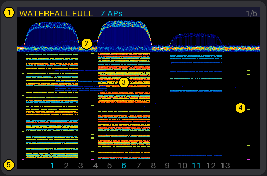
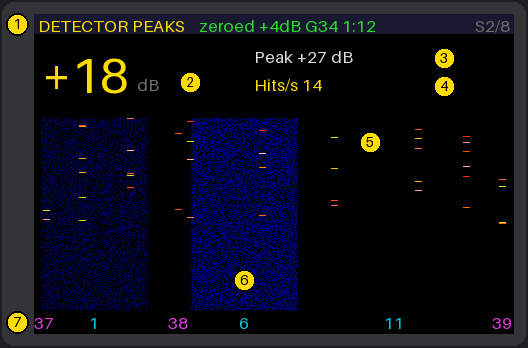
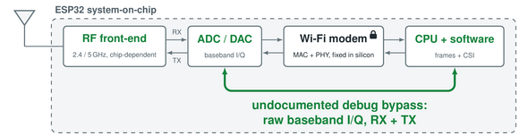
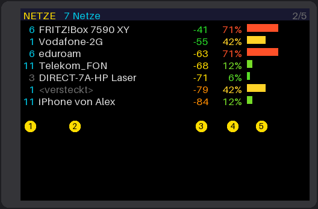
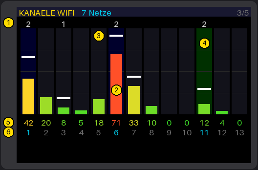
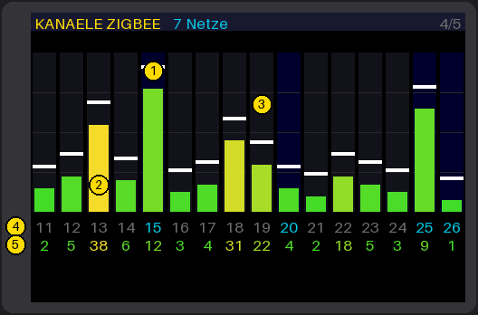
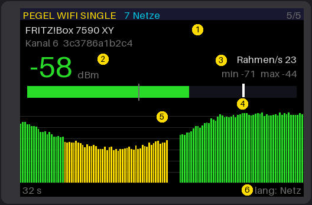
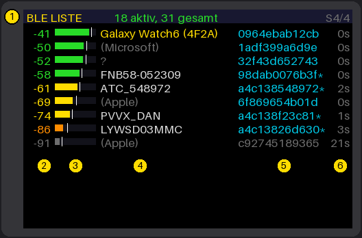
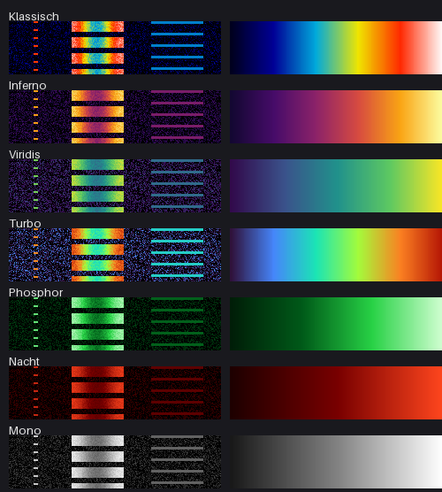

# ESP32 SDR Handheld Scanner with LCD

A pocket 2.4 GHz scanner built from a plain ESP32 board with a display. It
shows the Wi-Fi networks around you, measures how busy each channel really is,
draws a waterfall over channels 1–13, and has a **sniffer mode** that finds
active transmitters nearby: phones, Bluetooth headphones, BLE smartwatches.
No extra radio hardware is needed. The ESP32's own Wi-Fi receiver is used as a
software-defined radio.

It runs on two boards:

| Board | Chip | Display | Notes |
|---|---|---|---|
| **LILYGO TTGO T-Display** | ESP32 | 1.14" ST7789, 240×135, SPI | two buttons |
| **Guition JC3248W535** (JC3248W535EN) | ESP32-S3 N16R8 | 3.5" AXS15231B, 480×320, QSPI, capacitive touch | gapless capture, BLE device list |

This project builds on:

- **[ESPARGOS/esp-sdr](https://github.com/ESPARGOS/esp-sdr)**: raw I/Q samples
  from the ESP32 Wi-Fi receiver through an undocumented debug path, the receiver
  backends and the serial protocol.
- **[Skydev0h/esp-sdr-glow](https://github.com/Skydev0h/esp-sdr-glow)**: the
  ODROID-GO handheld fork with the on-device spectrum, the phosphor ("GLOW")
  display and the channel analysis this project grew from.

Their READMEs are kept in [docs/esp-sdr-glow-README.md](docs/esp-sdr-glow-README.md)
(the original ESP-SDR README follows below the line there). Everything they
describe, such as the browser viewer over USB, still works.

<p align="center">
  
  
</p>

> The pictures in this README are drawn mockups of the real pages, made with
> [tools/readme_images.py](tools/readme_images.py) after the firmware's layout,
> with typical data.

---

## Contents

- [How it works](#how-it-works)
- [Survey mode: networks and channel load](#survey-mode-networks-and-channel-load)
- [Sniffer mode: find active devices](#sniffer-mode-find-active-devices)
- [Controls](#controls)
- [Colour themes](#colour-themes)
- [Flash a ready-made firmware](#flash-a-ready-made-firmware)
- [Build from source](#build-from-source)
- [Hardware details](#hardware-details)
- [Serial diagnostics](#serial-diagnostics)
- [Limitations](#limitations)
- [Repository layout](#repository-layout)
- [License and credits](#license-and-credits)

---

## How it works

The ESP32's Wi-Fi receiver has a debug path that copies the raw ADC samples
(I/Q, 10 bit, up to 80 million per second) into RAM, bypassing the Wi-Fi modem.
ESP-SDR found and documented that path. This firmware takes short snapshots
(0.1–0.2 ms each) around 2442 MHz, so one snapshot covers the whole 2.4 GHz
band, and analyses them on the chip:

- **Channel load (airtime)** without decoding a single packet: each snapshot is
  split into 12.8 µs windows; a window counts as *busy* for a channel when the
  power in the middle 16 MHz of that channel is more than 6 dB over the noise
  floor. The busy share over ~2 s is the percentage. It counts everything that
  transmits there: all Wi-Fi networks including foreign and hidden ones,
  Bluetooth, Zigbee, microwave ovens.
- **Network names** come from a normal Wi-Fi scan that runs in small pieces
  between the measurements (every 9 s by default), only while NETWORKS is shown
  (and once at start, or on request): a scan stops the picture for a moment, and
  the other pages, best channel included, run on the SDR measurement alone.
  When you carry the board around, **hold the next-page key for 2 s** to switch
  on periodic scanning: every second one third of the band on WATERFALL,
  NETWORKS and CHANNELS WIFI (header: `scan auto`), so the network counts follow
  you. The picture keeps being drawn during a scan (on the second core); only
  the measurement pauses for the 0.15–0.3 s a scan takes. Without periodic
  scanning (`scan manual`), arriving at WATERFALL, NETWORKS or CHANNELS WIFI runs
  one full scan. The receiver is only
  recalibrated for a scan when it covers channels below the measuring
  frequency.
- The hardware AGC sets the gain for every packet; each sample carries its gain
  index and is scaled back to a common level. A phone right next to the board
  (speed test) therefore does not overdrive the picture.

<p align="center"></p>

---

## Survey mode: networks and channel load

The board starts here. The **next-page key** cycles the five pages: WATERFALL FULL →
NETWORKS → CHANNELS WIFI → CHANNELS ZIGBEE → LEVEL WIFI SINGLE.

### WATERFALL FULL


1. **Header:** page name, number of networks found (from the last scan), page
   number (`AUTO` or `CLIP` when those are active). It stays still; what
   changes is drawn below it.
2. **Phosphor spectrum:** every snapshot adds a little light where its trace
   lies, and everything fades within about a second. Levels that keep coming
   back glow hot, rare peaks stay faint. The picture is softened (levels
   interpolated between FFT bins, a 3 x 3 blur, eased from frame to frame), and
   every colour theme runs out into black at its faint end, so traces fade
   away instead of stopping at the theme's darkest colour.
3. **Occupancy waterfall:** newest row on top, about 7 s of history. Each row
   shows how often each frequency was busy; a Wi-Fi network appears as a 20 MHz
   wide band. Each column is shown against its own quiet level, so constant
   carriers disappear and bursts stand out.
4. **BLE advertising:** short dashes on the Bluetooth LE advertising channels
   37/38/39 (2402/2426/2480 MHz, marked magenta on the axis).
5. **Channel numbers 1–13,** fixed: 1/6/11 cyan, the rest grey (the airtime
   per channel and the best channel are on CHANNELS WIFI).

### NETWORKS



1. Channel. 2. SSID (`<versteckt>` = hidden). 3. Signal strength in dBm
(green strong, yellow medium, orange weak). 4. Measured airtime of that
channel. 5. The same as a bar (full = 100 %). With more networks than fit,
the list pages every 4 s.

### CHANNELS WIFI



1. Number of networks per channel. 2. Airtime bar (full = 100 %). 3. White
tick: peak airtime of the last seconds. 4. The quietest of 1/6/11 has a green
column. 5. Airtime in %. 6. Channel number (fixed, at the bottom). The
network counts come from the last scan; with periodic scanning (hold the
next-page key 2 s) every channel is renewed every 3 s.

**Airtime colours:** green up to ~15 %, yellow around 40 %, red from 75 %.
Neighbouring channels overlap, so a busy network on channel 6 also colours
channels 3–9.

### CHANNELS ZIGBEE



The 802.15.4 channels 11–26 (Zigbee, Thread, Matter; 2 MHz each at
2405 + 5·(n − 11) MHz). The snapshots alternate between two windows (LO 2422 and
2462 MHz), so the band-edge channels 11 and 26 are measured too.

1. Channels 15, 20, 25 and 26 (blue column, cyan number) sit between Wi-Fi 1,
6 and 11 and are the usual choice for a Zigbee network. 2. Level over the noise
floor (full = 40 dB), coloured by activity. 3. White tick: recent peak level.
4. Activity: share of time the channel was busy, in %. 5. Channel number
(fixed, at the bottom).

### LEVEL WIFI SINGLE (coverage of one network)



The signal strength of **one** Wi-Fi network, as fast as it sends: for walking
through a building and finding where coverage ends. The radio stays on that
network's channel (calibrated there) and takes the RSSI of every frame the
access point sends: ten beacons a second, plus all of its traffic. No scans and
no SDR measurements run while this page is open.

The page starts with the strongest network of the NETWORKS list. **Hold the mode
key / the next-page key** to step to the next / previous network; held on, it
steps once a second. No fine tapping needed.

1. Network name, channel and MAC. 2. Signal strength in dBm (green strong,
yellow medium, orange weak; `--` and `no signal` after 1 s without a frame).
3. Frames per second and the minimum / maximum since the network was chosen.
4. Bar from −100 to −30 dBm with the minimum (grey) and maximum (white) as ticks.
5. History: the strongest frame per 250 ms over 32 s (here: walking away from
the access point and back; a gap where nothing was heard). 6. `hold: network` =
hold to change the network.

---

## Sniffer mode: find active devices

The **mode key (short)** switches between survey and sniffer mode. The sniffer
is a field-strength detector: a phone or headphones in a bag 30–50 cm away
arrive 15–30 dB stronger than routers and devices across the room, however busy
the room is. Typical signatures:

- **Bluetooth headphones playing music:** confetti over the whole band
  (Bluetooth Classic hops 1600 times per second).
- **BLE (watch, earbuds, trackers):** short dots on 37/38/39.
- **Phone:** 20 MHz wide Wi-Fi bands plus BLE.

The **next-page key (short)** cycles the sniffer pages:

### FINDER WIDEBAND

Big number (dB above the room or the noise), history bars and a waterfall over
2400–2484 MHz. It takes snapshots in two windows (LO 2422 and 2462 MHz),
because the analogue filter is narrower than the band. It shows **where** in
the band something transmits and suits continuous transmitters.

The thin seam at 2442 MHz is where the two windows meet; a 40 MHz crystal
harmonic (2440 MHz) sits right there too and is blanked.

### DETECTOR PEAKS


What an analogue RF detector does, in software. The receiver records 25 ms
runs at 80 MS/s and computes a 64-point FFT every 16 µs (64 channels of
1.25 MHz from 2402 to 2481 MHz). A BLE packet lasts at least 80 µs, so it meets
several of these transforms and only 1.25 MHz of noise per channel. It shows
**whether and when** something transmits and catches short packets.

- **ESP32-S3 (JC3248):** gapless runs from a continuous ring buffer, the
  receiver listens about a third of the time (the rest draws the display).
- **ESP32 (T-Display):** snapshots of 193 µs back to back, the same 16 µs grid.
  Both cores work on it: core 0 takes the next snapshot while core 1
  transforms the last one.

1. Zeroing status with gain (`G34`) and age. 2. Big number: strongest excess
in dB over the learned room. 3. Peak since zeroing. 4. Hits per second
(slots over the threshold). 5. Bright dashes: transmissions above the room.
6. The room itself, shown faint (here an access point on channel 6). 7. Axis:
BLE advertising channels in magenta, Wi-Fi 1/6/11 in cyan.

### BEARING STRONGEST

"Warmer/colder": a big number, a bar with a best-value mark (reset when the
page opens) and an arrow showing whether the signal is getting stronger
(▲ green) or weaker (▼ cyan). **Body shadow bearing:** hold the board in front
of your chest and turn slowly. Your body damps signals from behind by 10–20 dB,
so the source is *in front of you* where the number peaks.

### FOCUS WIFI / FOCUS BLE / FOCUS ZIGBEE

One channel, heard longer. The analysis costs the same per sample whatever
the sample rate, so a capture of the same number of samples taken at a lower
rate listens longer; the price is a narrower span, which suits one channel.
The receiver's own sample clocks are used (80, 40 and 16 MS/s; `TDRATE`
checks them against the 40 MHz crystal's harmonic). Three pages, one per
system:

| Page | Channels | Rate | Span | Bin | Listening, JC3248 | Listening, T-Display |
|---|---|---|---|---|---|---|
| (survey, whole band) | | 80 MS/s | 2400–2484 MHz | 0.31 MHz | 9.3 ms/s | 4.8 ms/s |
| FOCUS WIFI | 1–13 (20 MHz) | 40 MS/s | ~34 MHz | 0.16 MHz | ~20 ms/s (2.2×) | ~9.5 ms/s (2×) |
| FOCUS BLE | 37 / 38 / 39 (2 MHz) | 16 MS/s | ~13 MHz | 0.06 MHz | 49 ms/s (5.3×) | 24 ms/s (5×) |
| FOCUS ZIGBEE | 11–26 (2 MHz) | 16 MS/s | ~13 MHz | 0.06 MHz | 49 ms/s (5.3×) | 24 ms/s (5×) |

A narrow channel also gains from the finer bins: the noise in each bin is
lower, so a weak 2 MHz signal stands further out of it. FOCUS is pure SDR: it
measures energy on the channel, whoever sends it; the level of one named
network is LEVEL WIFI SINGLE.

Each page shows the channel's **airtime** (big number), its **level** over the
floor, the floor, and the **listening time** per second; below, a phosphor
spectrum and an occupancy waterfall of the span with the channel between two
cyan marks. **Hold the next-page key / the mode key** to step to the next /
previous channel; held on, it steps once a second, so you can keep the finger
down until the channel you want comes up. Each page remembers its channel
across restarts. The first time, FOCUS WIFI starts on the strongest network's
channel, FOCUS BLE on 38 and FOCUS ZIGBEE on 15.

A 2 MHz channel sits 3 MHz off the receiver's centre, clear of its DC bins. A
Wi-Fi channel is too wide for that: the ~0.8 MHz around its centre, which the
analysis leaves out, is drawn from the neighbouring columns (802.11 OFDM
leaves its centre subcarrier empty anyway). BLE 39 (2480 MHz) lies on a harmonic of
the 40 MHz crystal, whose bins the analysis blanks in the same way. The
Wi-Fi pages use a 38 MHz analogue filter: flat within ~2 dB over the span (a
20 MHz filter cost the channel edges 3–4 dB, `TDSPAN`).

On the JC3248, DETECTOR PEAKS already hears the whole band without gaps;
FOCUS adds the fine frequency resolution there. On the T-Display FOCUS is
also the page that listens longest.

### BLE LIST (JC3248 only)



A classic BLE scan, including BLE 5 extended advertising, like a "BLE scanner"
phone app. This is the right tool for devices that transmit too little to
stand out of the room's Wi-Fi, such as a smartwatch connected to its phone.

1. Devices heard recently / in total. 2. Smoothed RSSI in dBm. 3. RSSI bar
(−100…−30 dBm), white tick = strongest packet. 4. Name, else the manufacturer
from the advertising data (Apple, Samsung, Google, Garmin, …); a **yellow**
name was first seen within the last 10 s. 5. MAC address as phone apps show
it; `*` = fixed (public) address. 6. Seconds since last heard (devices unseen
for 15 s turn grey and move down, after 2 min they go).

The nearest device is on top. **Next-page key long** clears the list.

The BT controller and the SDR receiver do not fit into the ESP32-S3's internal
RAM together, so **opening and leaving this page restarts the board** (about
1.5 s) into a BLE-only or SDR-only mode. Watches and phones change their random
MAC address every few minutes and then appear as a new entry.

### Zeroing (calibrates itself to the room)

**Next-page key long** zeroes the current sniffer page. Keep the board still for
6–15 s:

1. **`ranging G..`** (detector only): sets a fixed gain so the room's strongest
   signal sits 10–35 dB below full scale.
2. **`learning`:** learns the *highest* level the room reaches, per frequency.
3. **`checking +2dB`:** with 2 dB over that maximum, it counts how many pixels
   light up in the unchanged room. Above 0.3 % the margin rises by 2 dB and it
   checks again (a CFAR, as in radar).
4. **`zeroed +4dB`:** done, with the margin this room needed.

The reference then stays fixed (otherwise a device you stand next to would be
learned away). The header shows margin and age, e.g. `zeroed +4dB 2:15`.
**Mode key long** removes the zeroing (`no baseline`).

---

## Controls

There are two keys:

| Key | T-Display | JC3248 |
|---|---|---|
| **Next-page key** | left button (GPIO0) | right half of the screen, or the BOOT button |
| **Mode key** | right button (GPIO35) | left half of the screen |

| Key | short | long (1 s) |
|---|---|---|
| **Next-page** | next page | survey: full network scan now; kept held to 2 s on WATERFALL / CHANNELS WIFI: periodic scanning on/off (LEVEL: previous network) · sniffer: zero · FOCUS: next channel · BLE list: clear |
| **Mode** | survey ↔ sniffer | survey: next colour theme (LEVEL: next network) · sniffer: remove zeroing · FOCUS: previous channel |

- A touch that drops out for less than 0.12 s during a long hold still counts
  as held.
- **Hold bar:** while a key is held, a two-pixel bar along the top of the
  title row fills green towards a red goal at the right; once it is all red the
  hold has done its job and you can let go. Where the next-page key holds in
  two steps it runs over 2 s, with a white mark at 1 s (scan) and the goal at
  2 s (periodic scanning on/off).

## Colour themes

**Mode key long** in survey mode cycles Classic, Inferno,
Viridis, Turbo, Phosphor (green), Night (red) and Mono. The theme
applies to all waterfalls and the spectrum; Night turns the whole picture red
(text, bars and header too), for dark-adapted eyes. Its name shows in the header for
2 s; then it is saved in NVS and restored at the next start.

<p align="center"></p>

The waterfalls have persistence: each new row is mixed 60/40 with the previous
one and never drops below 82 % of it, with a light 1-2-1 blur across. Weak
signals stay visible as dark tones.

---

## Flash a ready-made firmware

[firmware/](firmware) holds complete images (bootloader, partition table and
app) to flash at address **0x0**:

| File | Board |
|---|---|
| [firmware/tdisplay-firmware.bin](firmware/tdisplay-firmware.bin) | LILYGO TTGO T-Display |
| [firmware/jc3248-firmware.bin](firmware/jc3248-firmware.bin) | Guition JC3248W535 |

**In the browser (no install, Chrome or Edge):**

1. Open <https://espressif.github.io/esptool-js/>.
2. Plug in the board, click **Connect** and choose its serial port (on a Mac
   e.g. `cu.usbserial-…`, `cu.wchusbserial…` or `cu.usbmodem…`), baud 921600.
3. Flash address `0x0`, choose the `.bin`, click **Program**.
4. **Disconnect**, then press reset or replug.

**With esptool** (`pip install esptool`):

```sh
esptool --chip esp32   -p /dev/ttyUSB0 -b 921600 write-flash 0x0 firmware/tdisplay-firmware.bin
esptool --chip esp32s3 -p /dev/ttyACM0 -b 921600 write-flash 0x0 firmware/jc3248-firmware.bin
```

If the JC3248 does not show up as a serial port, hold **BOOT** while plugging it
in.

---

## Build from source

The firmware calls private PHY functions of the Wi-Fi driver, so it needs
**exactly** the ESP-IDF commit pinned in
[firmware-targets.json](firmware-targets.json):
`25fe69f946311abdaf9ad56591f25fedbc20ac98` (ESP-IDF master, 2026). PlatformIO
and the Arduino IDE cannot build it. [ESP-DSP](https://github.com/espressif/esp-dsp)
is a git submodule under `components/esp-dsp`, so clone with `--recursive`
(or run `git submodule update --init` afterwards).

### 1. ESP-IDF at the pinned commit

**Linux / macOS:**

```sh
git clone https://github.com/espressif/esp-idf ~/esp/esp-idf-sdr
cd ~/esp/esp-idf-sdr
git checkout 25fe69f946311abdaf9ad56591f25fedbc20ac98
git submodule update --init --recursive
./install.sh esp32,esp32s3
. ./export.sh
```

**Windows (PowerShell).** Use short paths: deep ESP-IDF builds break Windows'
260-character path limit.

```powershell
git clone https://github.com/espressif/esp-idf C:\esp\esp-idf-sdr
cd C:\esp\esp-idf-sdr
git checkout 25fe69f946311abdaf9ad56591f25fedbc20ac98
git submodule update --init --recursive
$env:IDF_TOOLS_PATH = 'C:\esp\tools'
.\install.ps1 esp32,esp32s3
. .\export.ps1
```

### 2. Build and flash

Each board has its own build directory and configuration
(`sdkconfig.defaults.tdisplay`, `sdkconfig.defaults.jc3248`):

```sh
git clone --recursive https://github.com/doctormord/ESP32-SDR-Handheld-scanner-with-LCD sdr-scanner
cd sdr-scanner

# LILYGO TTGO T-Display (ESP32)
idf.py -B build-tdisplay -DIDF_TARGET=esp32 \
  -DSDKCONFIG=build-tdisplay/sdkconfig \
  -DSDKCONFIG_DEFAULTS=sdkconfig.defaults.tdisplay build
idf.py -B build-tdisplay -p /dev/ttyUSB0 flash

# Guition JC3248W535 (ESP32-S3)
idf.py -B build-jc3248 -DIDF_TARGET=esp32s3 \
  -DSDKCONFIG=build-jc3248/sdkconfig \
  -DSDKCONFIG_DEFAULTS=sdkconfig.defaults.jc3248 build
idf.py -B build-jc3248 -p /dev/ttyACM0 flash
```

On Windows, put the build directory on a short path (e.g. `-B C:\esp\build-jc3248`
with `-DSDKCONFIG=C:/esp/build-jc3248/sdkconfig`) or use
[tools/flash.ps1](tools/flash.ps1):

```powershell
powershell -ExecutionPolicy Bypass -File tools\flash.ps1 -Board jc3248 -Port COM8
```

> After changing an `sdkconfig.defaults.*` file, delete the build directory's
> `sdkconfig` (or the whole build directory). ESP-IDF only applies defaults to
> options that are not already set.

### 3. Make a single image for the browser flasher

```sh
cd build-tdisplay
esptool --chip esp32 merge-bin -o ../firmware/tdisplay-firmware.bin \
  --flash-mode dio --flash-freq 40m --flash-size 4MB \
  0x1000 bootloader/bootloader.bin 0x8000 partition_table/partition-table.bin 0x10000 esp_sdr.bin

cd ../build-jc3248
esptool --chip esp32s3 merge-bin -o ../firmware/jc3248-firmware.bin \
  --flash-mode dio --flash-freq 80m --flash-size 16MB \
  0x0 bootloader/bootloader.bin 0x8000 partition_table/partition-table.bin 0x10000 esp_sdr.bin
```

### Settings

In `sdkconfig.defaults.<board>` or with `idf.py menuconfig` → *ESP-SDR board*:

| Option | Default | Meaning |
|---|---|---|
| `CONFIG_ESP_SDR_SCAN_INTERVAL_S` | 9 | seconds for one full network scan over channels 1–13 (runs in 3 short parts); 0 = only on request |
| `CONFIG_ESP_SDR_PAGE_SECONDS` | 0 | 0 = pages change by button only, else seconds per page |
| `CONFIG_ESP_SDR_TDISPLAY_SPI_MHZ` | 80 | T-Display SPI clock; set 40 if a board shows pixel errors |

---

## Hardware details

### LILYGO TTGO T-Display (ESP32)

- Display ST7789 on SPI3: MOSI 19, SCLK 18, CS 5, DC 16, RST 23, backlight 4.
  Wrong orientation or swapped red/blue on a clone: `MADCTL` / `ROW_OFFSET` in
  [main/boards/tdisplay/lcd.c](main/boards/tdisplay/lcd.c).
- Buttons GPIO0 (left) and GPIO35 (right).
- Serial: the CH9102/CP210x bridge at 2 Mbaud.
- No PSRAM; about 50 frames/s.
- Runs on both cores: core 0 has Wi-Fi, the PHY and the measurements, core 1
  draws (and transforms the detector's snapshots). With enough free RAM it also
  keeps a whole frame (65 KB) and draws it while core 0 measures; `TDSTAT?`
  ends with `cores 2 framebuf 0|1`.

### Guition JC3248W535 (ESP32-S3)

- **PSRAM and flash run at 120 MHz** (instead of 80), as in the vendor's own
  demos (their "qio_opi" Arduino libraries); it gives about 3 frames/s. Octal
  PSRAM at 120 MHz is experimental in ESP-IDF: Espressif warns that the chip
  may crash when its temperature drifts by ~20 °C from power-on, and IDF's
  automatic re-tuning via the temperature sensor refuses this board's Boya
  flash. In daily use it has been stable. After a software restart (opening or
  leaving the BLE list) the USB serial port may stay silent until the board is
  unplugged once; the board itself runs on. To go back to 80 MHz, delete the
  120 MHz block at the end of `sdkconfig.defaults.jc3248` (and the build
  folder's `sdkconfig`).
- Display AXS15231B, 320×480 portrait, on QSPI (SPI2): CS 45, SCK 47,
  D0–D3 = 21/48/40/39, backlight 1. It runs at 40 MHz because the pins go
  through the GPIO matrix; 80 MHz showed scan lines.
- Runs on both cores: core 0 measures, core 1 draws the next picture into one
  of two PSRAM frames while the other one is being sent (a task of its own,
  which pauses between two chunks whenever a capture waits); about 24
  frames/s on WATERFALL FULL, with 45 captures/s of 0.2 ms each (the
  T-Display takes 0.1 ms ones). The phosphor fades outside the lock the
  measurement shares with drawing, so the measurement never waits for it. The data
  cache uses 64-byte lines (`sdkconfig.defaults.jc3248`): drawing into PSRAM
  and reading it back across rows for the panel misses half as often. (ESP-SDR's
  bare-metal core-1 helper for SPEC streaming to a host is off then; SPEC
  streaming runs on one core.)
- Partial updates: the frame goes out in 40 chunks of 12 panel rows (each a
  12-pixel-wide vertical slice of the landscape picture); chunks that did not
  change since they were last sent are skipped, the rest go out behind a row
  window (RASET). Calm pages send a few chunks or none, the waterfall all 40;
  every 2 s the whole frame goes out. `TDSTAT?` shows `chunks n`, and
  `TDLCDWIN [x y w h]` draws a red block through the window commands to check
  another panel. Column windows work too, but only aligned to 16 panel
  columns (unaligned ones show a ragged edge); sending only the changed
  columns of each chunk did not make frames faster, since the time then goes
  into rotating and comparing the picture on the CPU, so only row windows
  are used.
- Touch AXS15231B on I²C: SDA 4, SCL 8, address 0x3B. BOOT button GPIO0.
- 16 MB flash, 8 MB octal PSRAM (frame buffer and large tables live there).
- USB serial/JTAG (native USB-C).
- The continuous ring capture uses internal SRAM at 0x3FCB0000–0x3FCE0000
  (reserved from the heap).

Bring-up references for this board:
[DaradiciLevente/JC3248W535C-EspHome-NTP-Clock](https://github.com/DaradiciLevente/JC3248W535C-EspHome-NTP-Clock),
[AudunKodehode/JC3248W535EN-Touch-LCD](https://github.com/AudunKodehode/JC3248W535EN-Touch-LCD),
[HASwitchPlate/openHASP](https://github.com/HASwitchPlate/openHASP).
Another ESP-SDR display port:
[NeoCat/esp-sdr-TDongleC5-LCD](https://github.com/NeoCat/esp-sdr-TDongleC5-LCD).

---

## Serial diagnostics

Send a line over the serial port (T-Display: 2 Mbaud, JC3248: USB serial/JTAG,
any baud). Opening the port with DTR/RTS active resets the board; a terminal with
those lines off (or a script with `dtr=False, rts=False`) keeps it running.

| Command | Reply |
|---|---|
| `TDSTAT?` | survey state: page, gain, clipping, frame time, touch point (JC3248) |
| `TDPAGE n` / `TDSNIFF 0\|1` / `TDSNPAGE n` | switch page / mode / sniffer page (0 FINDER, 1 DETECTOR, 2 BEARING, 3–5 FOCUS WIFI / BLE / ZIGBEE, 6 BLE LIST) |
| `TDSCAN` / `TDSCANAUTO 0\|1` | full network scan now / periodic scanning off or on |
| `TDSCANCH c [ms]` | scan only channel `c` (passive for `ms` if given) and list every answer, raw (T-Display) |
| `TDSN?` / `TDNULL` | finder state / zero the finder |
| `TDDET?` / `TDDETZERO` | detector state (gain, floor, room, margin, per-slot excess) / zero it |
| `TDSPEC s [gain]` | detector listens for `s` seconds with the display paused, then prints per channel the strongest power and how often it was 15 dB over the median (for "does this device transmit at all?") |
| `TDZB?` | Zigbee channels: level over the floor / activity per channel |
| `TDCOV?` / `TDCOVSEL -1\|0\|1` | coverage page: network, channel, RSSI, min, max, frames/s / choose previous, strongest, next |
| `TDBLE?` | BLE list: every device with MAC, address type, RSSI, average, max, manufacturer id, packets, age, name |
| `TDFOCUS?` / `TDFOCUS n` | FOCUS: target, rate, captures/s, listening time, airtime, level, floor / choose target `n` (0–12 Wi-Fi 1–13, 13–15 BLE 37–39, 16–31 Zigbee 11–26), stored as that page's channel; in sniffer mode also goes to the page |
| `TDSPAN d lo bw n` | noise floor across the span: rate `d` as `TDRATE`, LO in MHz, analogue filter `bw` MHz (full width), `n` captures; minimum per bin (bursts drop out), in 2 MHz slices relative to the slice at the LO |
| `TDRATE 0\|1\|6 [lo]` | checks a sample rate (80 / 40 / 16 MS/s): at LO 2442 MHz (default) the crystal harmonic at 2440 MHz must show at −2.000 MHz; with another LO the expected offset is printed. On the JC3248 a carrier at 2448 MHz is stronger (at LO 2442: +6.0 MHz) |
| `TDSPINOISE [n]` | what display traffic during a capture costs: `n` pairs (default 40) of captures at a fixed gain, alternately with the display bus quiet and while picture data goes out; prints floor, mean spectrum change, the worst bins and each channel's level and airtime, quiet vs busy (survey mode) |

The ESP-SDR host protocol (`INFO`, `FREQ`, `CAP`, …) and the
[browser viewer](https://espargos.net/espsdr/app/) work as before; while a host
holds the radio, the display shows that and pauses.

### Why captures wait for a quiet display bus

Every capture waits until no picture data is on the display bus (on the
JC3248 the sending pauses between two chunks for it). `TDSPINOISE 100` shows
what that buys, measured in a room with live Wi-Fi (two runs each, gain 50,
AGC off):

| | JC3248W535 (QSPI, 40 MHz) | T-Display (SPI, 80 MHz) |
|---|---|---|
| Noise floor | **+2.1 to +2.3 dB** | **+1.5 dB** |
| Whole spectrum, mean | +3.4 to +3.6 dB | +2.1 dB |
| Bins more than 6 dB up | 13–16 of 210 | 4–6 of 210 |
| Spurs | +8 to +10 dB at 2420, 2430, 2460, 2470 MHz (10 MHz raster of the quad bus) | +6 to +8 dB at 2410–2416 and 2472–2475 MHz (near 30 × and 31 × 80 MHz) |
| Channel levels | +2 to +5 dB too high | +1 to +4.5 dB too high |
| Airtime | up to +3 points on channels 6–12 | channel 1 shows 15–26 % instead of 3–6 %, channels 2–3 up to 3× |

So a capture during display traffic would lose 1.5–2 dB of sensitivity,
show spurs that look like signals, and count display noise as airtime —
on the T-Display mostly at the band edges (channels 1–3 and 13).

---

## Limitations

- **2.4 GHz only.** The receiver covers the ESP32's Wi-Fi band. 5 GHz Wi-Fi,
  LTE/5G, NFC or a smartwatch's other radios are invisible to it. Broadband
  analogue RF detectors react to all of those.
- **Short, rare transmissions** (a connected BLE watch that only syncs now and
  then) can stay below the room's Wi-Fi in the SDR pages. Use **BLE LIST**: it
  decodes advertising and gets an RSSI per device.
- **T-Display:** no BLE list (no room in the ESP32 build); the detector there
  uses back-to-back snapshots instead of a gapless ring.
- **BLE LIST** restarts the JC3248 when you open or leave it (see above).
- The S3's gain table is not linear; the detector therefore ranges a fixed gain
  instead of using the AGC.

---

## Repository layout

| Path | Content |
|---|---|
| [main/boards/common/wifi_ui.c](main/boards/common/wifi_ui.c) | the UI of both boards: survey and sniffer pages, themes, zeroing, serial commands |
| [main/boards/common/zb.c](main/boards/common/zb.c) | band analysis: max-hold spectrum, occupancy, airtime, per-segment CFAR |
| [main/boards/common/aafont.h](main/boards/common/aafont.h) | anti-aliased digits and text (generated by [tools/gen_fonts.py](tools/gen_fonts.py)) |
| [main/boards/tdisplay/](main/boards/tdisplay) | T-Display: ST7789 driver, buttons |
| [main/boards/jc3248/](main/boards/jc3248) | JC3248W535: QSPI panel with PSRAM frame, touch |
| [main/targets/esp32/receiver.c](main/targets/esp32/receiver.c) | ESP32 receiver backend, local UI API, snapshot channelizer |
| [main/targets/esp32s3/receiver.c](main/targets/esp32s3/receiver.c) | ESP32-S3 receiver backend, local UI API, BLE start mode |
| [main/common/ring_capture.c](main/common/ring_capture.c) | S3 continuous ring capture, incl. the detector's envelope/channelizer mode |
| [main/common/ble_scan.c](main/common/ble_scan.c) | NimBLE observer for the BLE list |
| `sdkconfig.defaults.tdisplay`, `sdkconfig.defaults.jc3248` | board configurations |
| [firmware/](firmware) | ready-made images |
| [images/](images) | README pictures; [tools/readme_images.py](tools/readme_images.py) draws them |

The other targets of ESP-SDR (C2, C3, C5, C6, H2, S2, S31, ODROID-GO) are still
in the tree and build as described in
[docs/esp-sdr-glow-README.md](docs/esp-sdr-glow-README.md).

---

## License and credits

GPL-3.0-or-later, like ESP-SDR and esp-sdr-glow (see [LICENSE](LICENSE)).

- ESP-SDR by [ESPARGOS](https://github.com/ESPARGOS/esp-sdr): receiver
  backends, protocol, the SDR bypass.
- esp-sdr-glow by [Skydev0h](https://github.com/Skydev0h/esp-sdr-glow): the
  handheld UI, GLOW display and channel analysis.
- [ESP-DSP](https://github.com/espressif/esp-dsp) by Espressif, Apache-2.0 (submodule).
- Font: Aileron by Sora Sagano, CC0.
